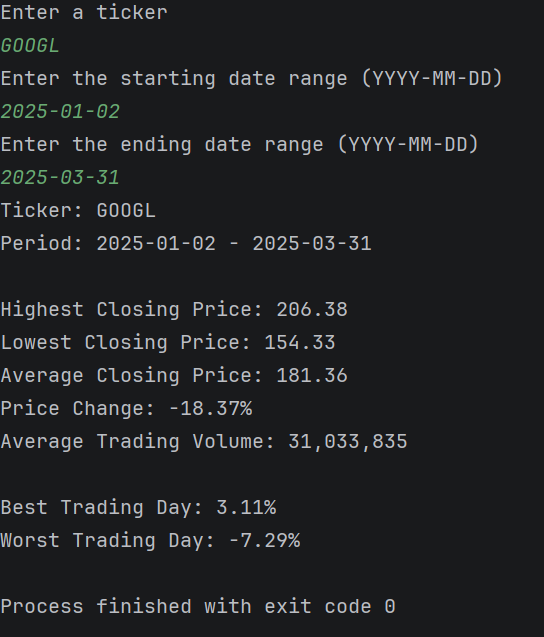
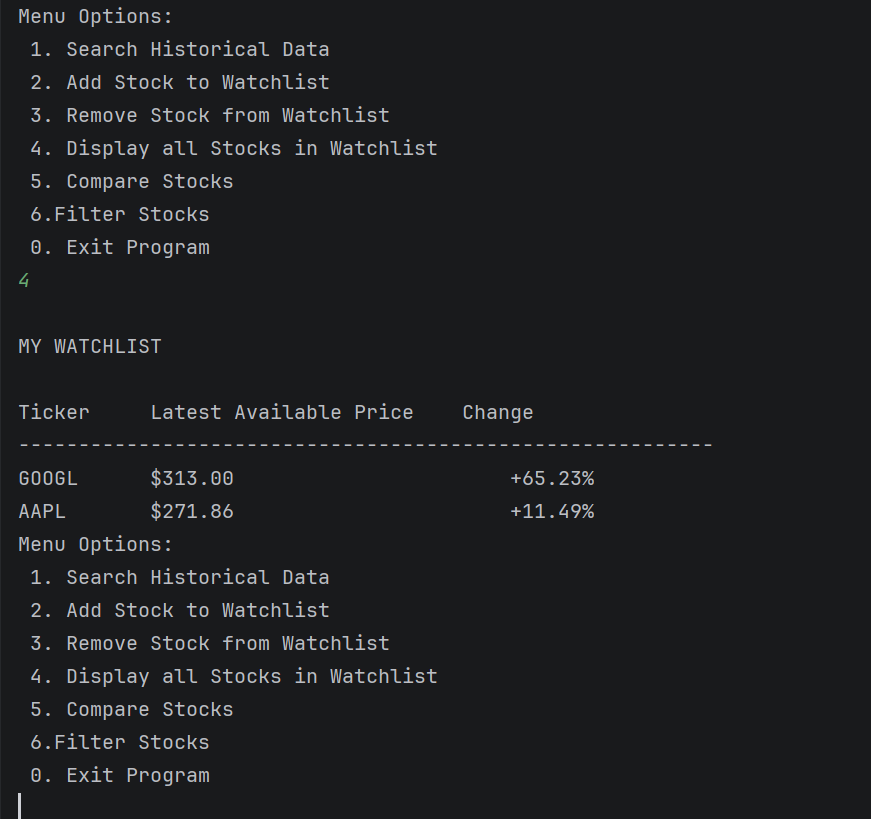
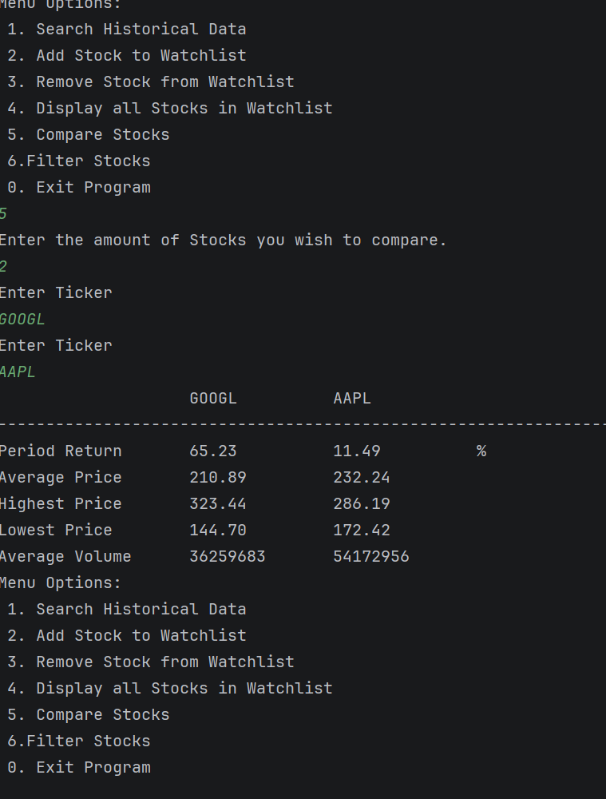

# OOP-Market-Analysis-Tool
## Description on how to use project
The project analyzes the stock market data collected in CSV files. The program outputs various metrics, relevant to the date range selected.

Based on the Market Data folder attached, pick any of the ticker names on the files. Input the ticker name following the same syntax as on the file. Then specify a date range using the dates in the file, make sure to follow a YYYY-MM-DD format. The program is design to check for a correct date format, the existence of the data, that the start date is before the end date. 

Finally, the Market Assistant will output the different metrics. These include highest closing price, lowest closing price, average closing price, average closing price, percentage change over selected period, average trading volume, best trading day (% increase), worst trading day (% decrease).

## Example output: 





## Project Structure:
## Main.java

Acts as the entry point of the application and manages the menu-driven user interface.

### Responsibilities

- Display menu options
- Process user selections
- Coordinate communication between classes
- Manage program execution flow
- Handle application startup and shutdown
- Maintain the application loop

---

## PriceRecord.java

Represents a single trading day of stock market data.

### Attributes

- Date
- Opening Price
- High Price
- Low Price
- Closing Price
- Trading Volume

### Methods

```java
getDate()
getOpen()
getHigh()
getLow()
getClose()
getVolume()
```
---

## ReadFile.java

Responsible for reading stock market CSV files and converting each record into PriceRecord objects.

### Responsibilities

- Open stock data files
- Parse CSV records
- Create PriceRecord objects
- Retrieve historical records
- Filter records by date range
- Validate ticker symbols
- Determine earliest and latest available dates

### Methods

```java
read()
tickerExists()
getEarliestDate()
getLatestDate()
```

---

## Validation.java

Provides reusable validation methods used throughout the application.

### Responsibilities

- Validate integer input
- Validate double input
- Validate long input
- Validate ticker symbols
- Validate date formatting

### Methods

```java
getValidTicker()
getValidInt()
getValidDouble()
getValidLong()
validDate()
```

---

## Watchlist.java

Manages the user's personal watchlist.

### Responsibilities

- Add stocks to the watchlist
- Remove stocks from the watchlist
- Check if a stock exists
- Check if the watchlist is empty
- Display watchlist contents

### Methods

```java
addStock()
removeStock()
stockExists()
isEmpty()
getStocks()
```

---

## Filter.java

Provides methods for filtering collections of stock market records.

### Responsibilities

- Filter by minimum closing price
- Filter by minimum trading volume
- Return filtered collections for analysis

### Methods

```java
filterByPrice()
filterByVolume()
```

---

## Calculations.java

Performs all statistical analysis and performance calculations.

### Responsibilities

- Calculate highest closing price
- Calculate lowest closing price
- Calculate average closing price
- Calculate latest available closing price
- Calculate overall return
- Calculate average trading volume
- Calculate largest daily increase
- Calculate largest daily decrease

### Methods

```java
highestClose()
lowestClose()
averageClose()
latestClose()
percentChange()
averageTradingVolume()
percentageIncrease()
percentageDecrease()
```

### Example Calculations

- Highest Closing Price
- Lowest Closing Price
- Average Closing Price
- Period Return
- Latest Available Price
- Average Trading Volume
- Best Trading Day
- Worst Trading Day

---

## Formatter.java

Handles all user output and presentation of information.

### Responsibilities

- Display stock analysis
- Display stock comparisons
- Display watchlists
- Display filtered datasets
- Format console output

### Methods

```java
DisplayWatchList()
CompareTickers()
displayFilteredData()
```

### Features

- Historical stock analysis reports
- Watchlist reports
- Stock comparison tables
- Filtered market data tables

---

# Features Implemented

## Historical Stock Analysis

- Highest Closing Price
- Lowest Closing Price
- Average Closing Price
- Percentage Return
- Average Trading Volume
- Best Trading Day
- Worst Trading Day

## Watchlist Management

- Add Stocks
- Remove Stocks
- View Watchlist

## Stock Comparison

- Period Return
- Average Price
- Highest Price
- Lowest Price
- Average Volume

## Filtering

- Filter by Price
- Filter by Trading Volume
- Filter by Date Range

## Input Validation

- Ticker Validation
- Date Validation
- Integer Validation
- Double Validation
- Long Validation

---

## Diagram


## Development Efforts
### Sandra
Milestone 1: Responsible for development of calculations.java, and Formatter.java, created the UML diagram. Furthermore, contributed to debugging and testing, and assisted with implementing error handling. 

Milestone 2: Responsible for the updating READ.md and creating new UML Class Diagram

### Xavier
Milestone 1: Responsible for development of Main.java, ReadFile.java, and cleanUp.java, created README.md and contributed to the final testing before commitment. 

Milestone 2: Responsible for creating Validation.java, Filter.java and Watchlist.java. Lastly assisted in reworking files to improve cohesion and coupling.
