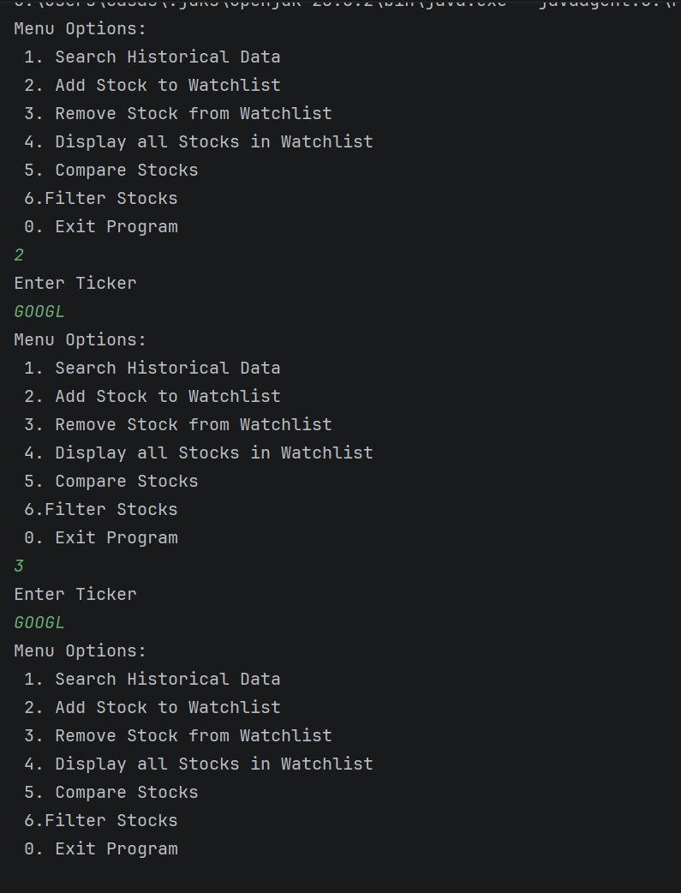

# OOP-Market-Analysis-Tool
## Description on how to use project
The project analyzes the stock market data collected in CSV files. The program outputs various metrics, relevant to the date range selected.

Based on the Market Data folder attached, pick any of the ticker names on the files. Input the ticker name following the same syntax as on the file. Then specify a date range using the dates in the file, make sure to follow a YYYY-MM-DD format. The program is design to check for a correct date format, the existence of the data, that the start date is before the end date. 

Finally, the Market Assistant will output the different metrics. These include highest closing price, lowest closing price, average closing price, average closing price, percentage change over selected period, average trading volume, best trading day (% increase), worst trading day (% decrease).

## Example output: 

## Project Structure:
### Main.java
Runs the menu and user input
Important code: loop control, input, cleanup
### ReadFile.java
Reads the stock csv files and turn the rows into PriceRecord objects
Important code: file path, BufferedReader, FIleReader, readLine(), parsing, date filtering
### Filter.java
Narrows a list of records down to one product
Important code: ArrayList
### Calculations.java
Computes statistics from a list of price records
Important code: best & worst day, for loop, min & max pattern, percent record formula
### Formater.java
Handles all the printing and table formatting
Important code: printf, casting

## Diagram

## Development Efforts
### Sandra
Milestone 1: Responsible for development of calculations.java, and Formatter.java, created the UML diagram. Furthermore, contributed to debugging and testing, and assisted with implementing error handling. 

Milestone 2: Responsible for the updating READ.md and creating new UML Class Diagram

### Xavier
Milestone 1: Responsible for development of Main.java, ReadFile.java, and cleanUp.java, created README.md and contributed to the final testing before commitment. 

Milestone 2: Responsible for creating Validation.java, Filter.java and Watchlist.java. Lastly assisted in reworking files to improve cohesion and coupling.
